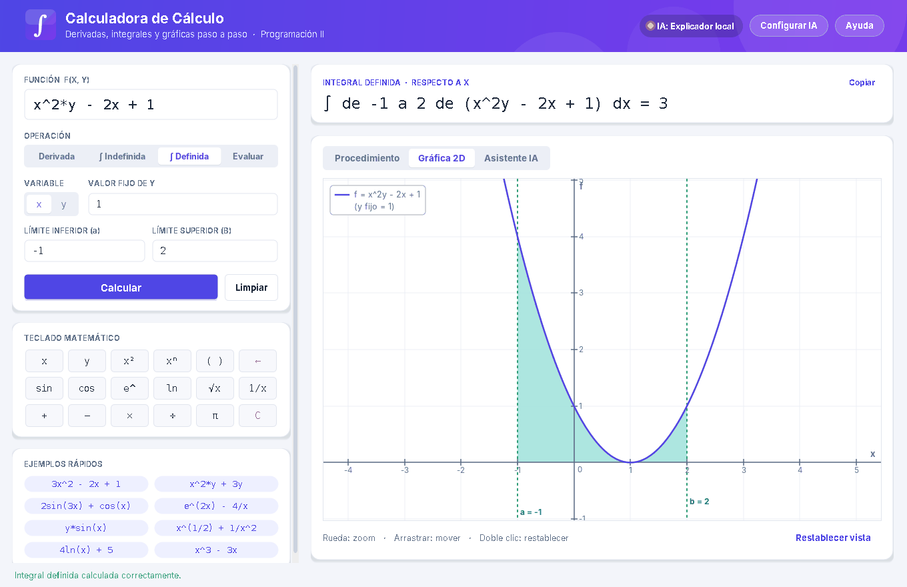
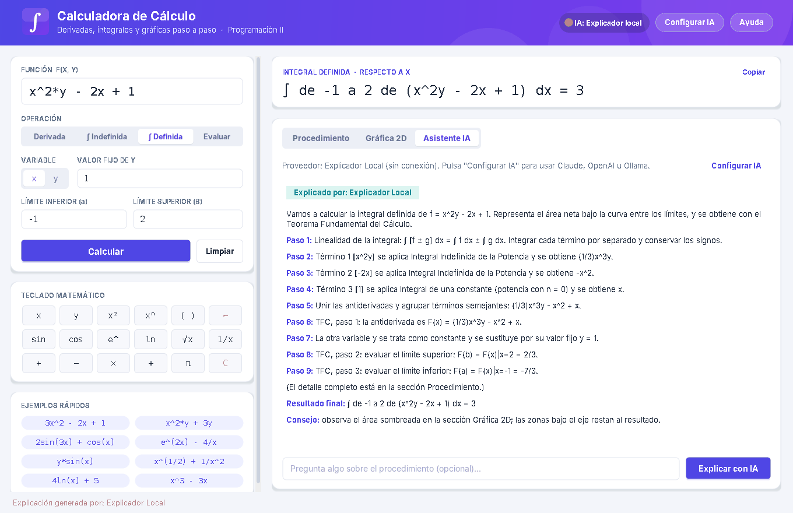

# Calculadora de Cálculo con Asistente de IA y Graficador Integral de Funciones

Proyecto universitario de **Programación II – Ingeniería en Sistemas**.
Aplicación de escritorio en **Java Swing** que deriva, integra y evalúa funciones de una o dos variables, explica cada regla aplicada paso a paso, grafica la función con el área de la integral sombreada y cuenta con un **asistente de IA** que explica (sin calcular) el procedimiento.



## Características

- **Derivadas** (parciales): constante, potencia, suma/resta y regla de la cadena para sin, cos, e^ y ln.
- **Integrales indefinidas**: potencia, 1/v → ln|v|, integrales inmediatas trigonométricas y exponenciales, y `+ C`.
- **Integrales definidas** con el Teorema Fundamental del Cálculo y validación de dominio (integrales impropias, raíces no reales).
- **Procedimiento paso a paso** generado por cada clase de término (`describirDerivada` / `describirIntegral`).
- **Resultados exactos**: enteros, fracciones N/D (D ≤ 100) y decimales.
- **Interfaz moderna** dibujada con Graphics2D: tarjetas, botones redondeados, selectores segmentados y teclado matemático.
- **Graficador 2D**: antialiasing, cuadrícula, zoom con la rueda, arrastre y área sombreada con `AlphaComposite`.
- **Asistente de IA**: Anthropic, OpenAI u Ollama local, con respaldo automático al **Explicador Local** sin red.
- **Sin dependencias**: JDK 11+, `java.net.http.HttpClient` y JSON manual (`JsonSencillo`).
- **99 pruebas automáticas** sin JUnit.

## Inicio rápido (Windows / PowerShell)

```powershell
.\build.bat              # compila y genera dist\CalculadoraCalculo.jar
.\ejecutar.bat           # abre la calculadora
.\ejecutar_pruebas.bat   # ejecuta las pruebas
```

O directamente: `java -jar dist\CalculadoraCalculo.jar`

### Asistente de IA (opcional)

Pulse **Configurar IA** en la aplicación, elija Claude, OpenAI u Ollama, pegue su clave, pulse **Probar conexión** y **Guardar**. Sin configuración se usa el Explicador Local (sin Internet).



## Estructura

```
calculadora java/
├── src/calculadora/
│   ├── Main.java
│   ├── modelo/        Variable, Termino, TerminoPolinomico, TerminoFuncional,
│   │                  TerminoSeno, TerminoCoseno, TerminoExponencial, TerminoLogaritmico,
│   │                  Expresion, ResultadoCalculo, Calculadora (fachada)
│   ├── analisis/      AnalizadorExpresion (descenso recursivo)
│   ├── excepciones/   CalculadoraException + 4 subclases
│   ├── util/          FormatoNumeros, JsonSencillo
│   ├── ia/            ProveedorIA, ProveedorAnthropic, ProveedorCompatibleOpenAI,
│   │                  ConfiguracionIA, ExplicadorLocal, TutorIA
│   ├── vista/         VentanaCalculadora, PanelGrafico2D
│   └── pruebas/       PruebasCalculadora
├── docs/
│   ├── Documento_Tecnico.md
│   ├── Manual_de_Usuario.md
│   ├── uml/           diagramas PlantUML y Mermaid
│   └── capturas/
├── build.bat · ejecutar.bat · ejecutar_pruebas.bat
├── config.properties.ejemplo
└── .gitignore
```

## Ejemplos

| Entrada | Operación | Resultado |
|---|---|---|
| `3x^2 - 2x + 1` | d/dx | `6x - 2` |
| `x^2*y` | ∂/∂y | `x^2` |
| `y*sin(x)` | ∂/∂x | `ycos(x)` |
| `e^(2x)` | ∫ dx | `(1/2)e^(2x) + C` |
| `1/x` | ∫ dx | `ln\|x\| + C` |
| `sin(x)` | ∫ de 0 a π | `2` |

## Documentación

- [Documento Técnico](docs/Documento_Tecnico.md): arquitectura, reglas matemáticas, parser, IA y pruebas.
- [Manual de Usuario](docs/Manual_de_Usuario.md): instalación, uso, sintaxis y errores frecuentes.
- [Diagramas UML](docs/uml/): clases y secuencia (PlantUML y Mermaid).
