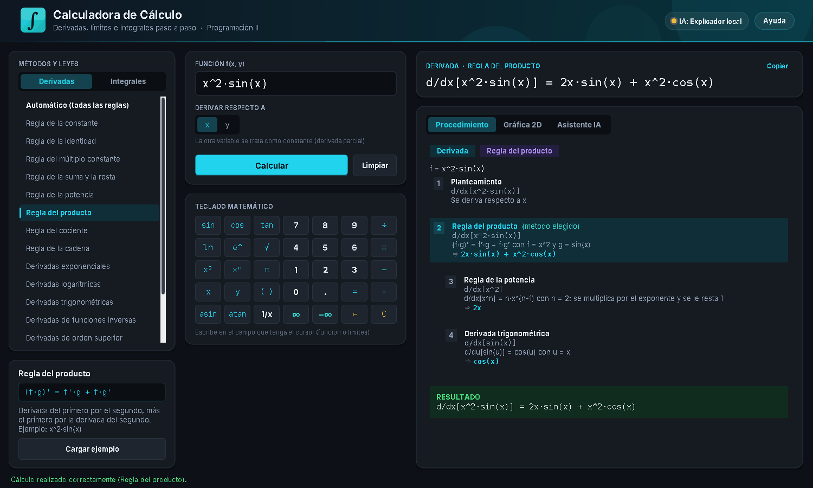

# Calculadora de Cálculo con Asistente de IA y Graficador Integral de Funciones

Proyecto final de **Cálculo II y Programación II** (UMG) – Ingeniería en Sistemas.
Aplicación de escritorio en **Java Swing** que deriva, integra y calcula límites de funciones de una o dos variables, resuelve aplicaciones (recta tangente, máximos y mínimos, área entre curvas), explica cada regla aplicada paso a paso, grafica la función con el área sombreada y cuenta con un **asistente de IA** que explica (sin calcular) el procedimiento.


## Características

- **Lista de métodos** para elegir la ley o regla: constante, identidad, múltiplo, suma, potencia, producto, cociente, cadena, exponenciales, logarítmicas, trigonométricas, inversas, orden superior, implícita, parciales y **L'Hôpital**; en integrales: propiedades, potencia, logaritmo, exponenciales, trigonométricas, **sustitución, partes, fracciones parciales, sustitución trigonométrica**, TFC, límites iguales, inversión, aditividad e **impropias con ±∞**.
- **Procedimiento paso a paso** con el método elegido resaltado.
- **Aplicaciones**: límite de una función (también **laterales**: `0+`, `0-`), **recta tangente y normal**, **máximos, mínimos e inflexión** y **área entre dos curvas**.
- **Motor simbólico** propio (árbol de expresión, simplificador, derivador, integrador con verificación). Incluye funciones hiperbólicas, |x|, potencias de seno y coseno y funciones de e^x.
- **Integrales definidas respecto a x o a y**, con resultado exacto (`e - 1`, `π/4`, `2y`) y **comprobación numérica**; si no hay antiderivada elemental (`e^(-x^2)`, `sin(x)/x`) se da un **valor aproximado** (Gauss-Kronrod).
- **Lectura flexible**: `sinx`, `sin 2x`, `ln x`, `sen`, `arcsen`, `raiz`, `5!`, `f(x) = ...`. Avisa cuando algo se puede leer de dos formas (`e^2x`, `1/2x`) y sugiere correcciones (`son(x)` → `sin(x)`).
- **Vista previa** de la fórmula mientras se escribe (fracciones, exponentes y raíces dibujados).
- **Límites infinitos** (∞ y −∞) en L'Hôpital y en integrales impropias.
- **Graficador 2D**: derivadas, áreas (también hasta ∞ y entre dos curvas), recta tangente, máximos y mínimos marcados, puntos de límite y curvas implícitas.
- **Historial** de los últimos cálculos y **exportación** del procedimiento a HTML o PDF.
- **Interfaz en modo oscuro** con teclado matemático (números, funciones, |x|, ∞).
- **Asistente de IA** (Claude, OpenAI u Ollama) con respaldo al Explicador Local.
- **Sin dependencias**: JDK 11+, `java.net.http.HttpClient` y JSON manual.
- **271 pruebas automáticas** sin JUnit (derivadas e integrales comprobadas numéricamente).



## Inicio rápido (Windows / PowerShell)

```powershell
.\build.bat              # compila y genera dist\CalculadoraCalculo.jar
.\ejecutar.bat           # abre la calculadora
.\ejecutar_pruebas.bat   # ejecuta las pruebas
```

O directamente: `java -jar dist\CalculadoraCalculo.jar`

### Asistente de IA (opcional)

Copie `config.properties.ejemplo` como `config.properties` y complete `proveedor`, `api_key` y `modelo` (o use la variable de entorno `CALCULADORA_IA_API_KEY`). Ese archivo está en `.gitignore`: **la clave nunca se escribe en el código ni se sube a GitHub**. Sin clave se usa el Explicador Local (sin Internet); Ollama funciona sin clave.

## Estructura

```
calculadora java/
├── src/calculadora/
│   ├── Main.java
│   ├── modelo/        ResultadoCalculo, MetodoCalculo, EntradaCalculo, Calculadora (fachada)
│   ├── simbolico/     Árbol de expresión, AnalizadorSimbolico, Sugeridor, Simplificador,
│   │                  Derivador, Integrador, IntegracionNumerica, Limites, BuscadorRaices
│   ├── excepciones/   CalculadoraException + 4 subclases
│   ├── util/          FormatoNumeros, JsonSencillo
│   ├── ia/            ProveedorIA, ProveedorAnthropic, ProveedorCompatibleOpenAI,
│   │                  ConfiguracionIA, ExplicadorLocal, TutorIA
│   ├── vista/         VentanaCalculadora, PanelMetodos, VistaFormula, PanelGrafico2D,
│   │                  Historial, ExportadorProcedimiento, componentes y estilo
│   └── pruebas/       PruebasCalculadora
├── docs/
│   ├── Documento_Tecnico.md
│   ├── Manual_de_Usuario.md
│   ├── uml/           diagramas PlantUML y Mermaid
│   └── capturas/
├── build.bat · ejecutar.bat · ejecutar_pruebas.bat
├── config.properties.ejemplo
└── .gitignore
```

## Ejemplos

| Método | Entrada | Resultado |
|---|---|---|
| Regla del producto | `x^2·sin(x)` | `2x·sin(x) + x^2·cos(x)` |
| Regla de L'Hôpital | `sin(x)/x`, x → 0 | `1` |
| Derivación implícita | `x^2 + y^2 = 25` | `dy/dx = -x/y` |
| Por partes | `x·e^x` | `x·e^x - e^x + C` |
| Fracciones parciales | `1/(x^2 - 1)` | `ln\|x - 1\|/2 - ln\|x + 1\|/2 + C` |
| Sustitución trigonométrica | `1/√(4 - x^2)` | `arcsin(x/2) + C` |
| Impropia | `1/x^2` en [1, ∞) | `1` |
| Sin antiderivada elemental | `e^(-x^2)` en [0, 1] | `≈ 0.74682413` |
| Respecto a la otra variable | `x·y` en [0, 2], dx | `2y` |
| Recta tangente | `x^2 - 2x + 3` en x = 2 | `y = 2x - 1` |
| Máximos y mínimos | `x^3 - 3x` en [-3, 3] | máx. (-1, 2), mín. (1, -2) |
| Área entre curvas | `x` y `x^2` | `1/6` |

## Documentación

- [Documento Técnico](docs/Documento_Tecnico.md): arquitectura, reglas matemáticas, parser, IA y pruebas.
- [Manual de Usuario](docs/Manual_de_Usuario.md): instalación, uso, sintaxis y errores frecuentes.
- [Diagramas UML](docs/uml/): clases y secuencia (PlantUML y Mermaid).
