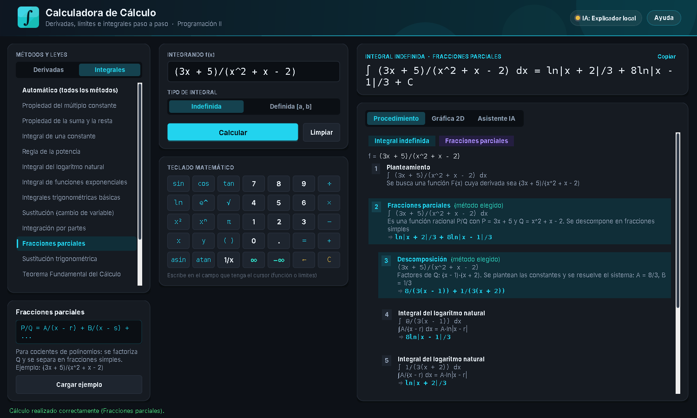
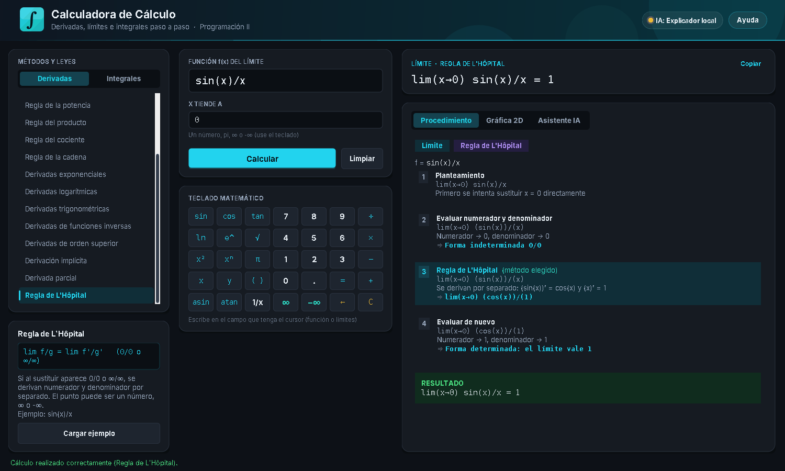
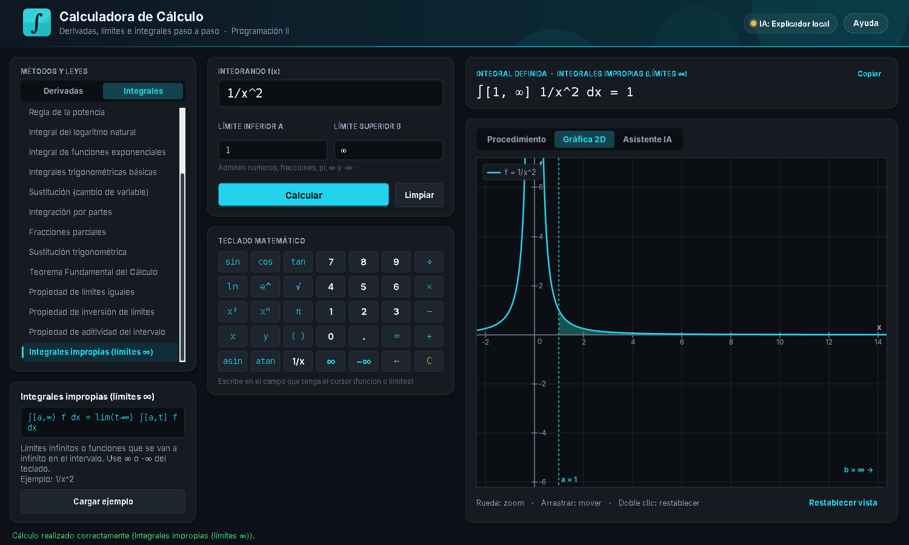
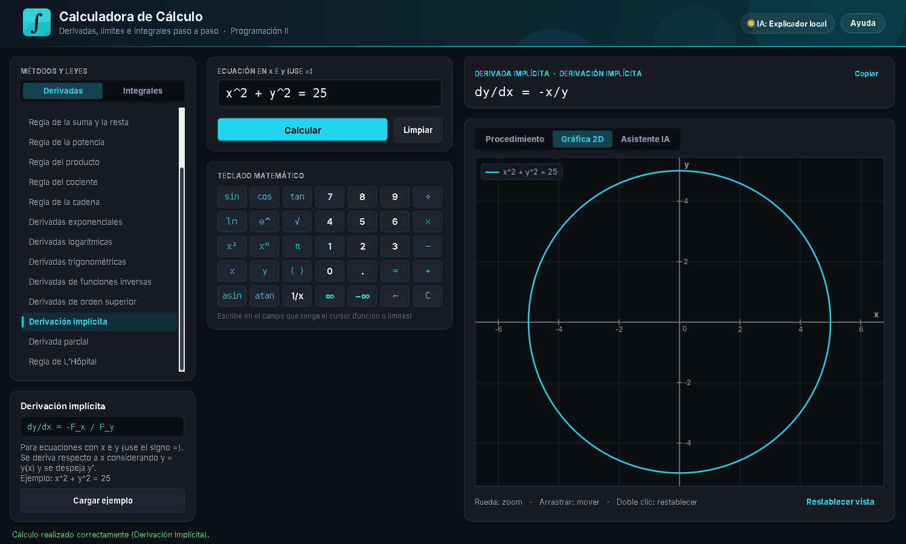

# Manual de Usuario

**Calculadora de Cálculo con Asistente de IA y Graficador Integral de Funciones**

---

## 1. Requisitos

- Windows 10 u 11.
- **Java 11 o superior** para ejecutar. Para volver a compilar (`build.bat`) hace falta un **JDK** (comando `javac`).

```powershell
java -version
javac -version
```

- Conexión a Internet **solo** si se usa un asistente de IA en línea. Sin Internet la calculadora funciona completa con el Explicador Local.

## 2. Ejecución

En PowerShell, dentro de la carpeta del proyecto:

```powershell
.\ejecutar.bat           # abre la calculadora (o doble clic en ejecutar.bat)
.\build.bat              # vuelve a compilar y crea dist\CalculadoraCalculo.jar
.\ejecutar_pruebas.bat   # ejecuta las 171 pruebas automáticas
```

## 3. La ventana


La ventana (modo oscuro) tiene tres columnas:

| Columna | Contenido |
|---|---|
| **Métodos y leyes** | Selector **Derivadas / Integrales**, la lista de métodos y una tarjeta con la fórmula, la explicación y el botón **Cargar ejemplo**. |
| **Datos** | La función y los campos que pide el método elegido, más el **teclado matemático**. |
| **Resultado** | El resultado grande (con botón **Copiar**) y las secciones **Procedimiento**, **Gráfica 2D** y **Asistente IA**. |

### Uso en tres pasos

1. Elija **Derivadas** o **Integrales** y un método de la lista.
2. Escriba la función (o pulse **Cargar ejemplo**).
3. Pulse **Calcular** (o Enter).

En **Procedimiento**, los pasos que usan el método elegido aparecen **resaltados en cian** con la etiqueta *(método elegido)*. Si la función no necesita ese método, aparece una **nota** que lo explica y sugiere un ejemplo.

## 4. Lista de métodos

### Derivadas

| Método | Fórmula | Ejemplo |
|---|---|---|
| Automático | todas las reglas necesarias | `x^2·sin(x) + e^(3x)` |
| Regla de la constante | d/dx[c] = 0 | `7 + x^2` |
| Regla de la identidad | d/dx[x] = 1 | `x + 5` |
| Regla del múltiplo constante | (c·f)' = c·f' | `5x^3` |
| Regla de la suma y la resta | (f ± g)' = f' ± g' | `x^3 - 4x + 2` |
| Regla de la potencia | (xⁿ)' = n·x^(n−1) | `x^5 + √(x) + 1/x^2` |
| Regla del producto | (f·g)' = f'·g + f·g' | `x^2·sin(x)` |
| Regla del cociente | (f/g)' = (f'·g − f·g')/g² | `sin(x)/x` |
| Regla de la cadena | [f(g(x))]' = f'(g(x))·g'(x) | `sin(x^2 + 1)` |
| Derivadas exponenciales | (e^u)' = e^u·u',  (a^u)' = a^u·ln(a)·u' | `e^(3x) + 2^x` |
| Derivadas logarítmicas | (ln u)' = u'/u | `ln(x^2 + 1)` |
| Derivadas trigonométricas | (sin u)' = cos u·u', ... | `tan(2x) + sec(x)` |
| Derivadas de funciones inversas | (arctan u)' = u'/(1+u²), ... | `arctan(x^2)` |
| Derivadas de orden superior | f'' = (f')' | `x^4 - 3x^2 + sin(x)`, orden 3 |
| Derivación implícita | dy/dx = −F_x/F_y | `x^2 + y^2 = 25` |
| Derivada parcial | la otra variable es constante | `x^2·y^3 + sin(x·y)` respecto a y |
| Regla de L'Hôpital | lim f/g = lim f'/g' (0/0, ∞/∞) | `sin(x)/x` con x → 0 |

### Integrales

| Método | Fórmula | Ejemplo |
|---|---|---|
| Automático | prueba todos los métodos | `x·e^x + 1/(x^2 + 1)` |
| Propiedad del múltiplo constante | ∫c·f = c·∫f | `7x^3` |
| Propiedad de la suma y la resta | ∫(f ± g) = ∫f ± ∫g | `x^2 + cos(x) - 3` |
| Integral de una constante | ∫k dx = kx + C | `5` |
| Regla de la potencia | ∫xⁿ = x^(n+1)/(n+1) | `x^4 + √(x)` |
| Integral del logaritmo natural | ∫1/x = ln\|x\| | `3/x + 1/(2x + 1)` |
| Integral de funciones exponenciales | ∫e^(kx) = e^(kx)/k | `e^(2x) + 3^x` |
| Integrales trigonométricas básicas | ∫sin = −cos, ∫sec² = tan... | `sin(3x) + sec(x)^2` |
| Sustitución (cambio de variable) | u = g(x) | `2x·cos(x^2)` |
| Integración por partes | ∫u dv = uv − ∫v du (LIATE) | `x·e^x` |
| Fracciones parciales | P/Q = A/(x−r) + ... | `(3x + 5)/(x^2 + x - 2)` |
| Sustitución trigonométrica | x = a·sinθ, a·tanθ, a·secθ | `√(9 - x^2)` |
| Teorema Fundamental del Cálculo | ∫[a,b] f = F(b) − F(a) | `x^2` en [0, 3] |
| Propiedad de límites iguales | ∫[a,a] f = 0 | `x^3 + 1` en [2, 2] |
| Propiedad de inversión de límites | ∫[a,b] = −∫[b,a] | `x^2` en [3, 0] |
| Propiedad de aditividad del intervalo | ∫[a,b] = ∫[a,c] + ∫[c,b] | `x^2` en [0, 3] con c = 1 |
| Integrales impropias | límites ∞ o funciones que se van a ∞ | `1/x^2` en [1, ∞) |

En los métodos de integración que no son propiedades se elige **Indefinida** o **Definida [a, b]**.



## 5. Campos según el método

| Campo | Aparece en |
|---|---|
| **Derivar respecto a** x / y | Derivadas (la otra variable se trata como constante) |
| **Orden de la derivada (n)** | Derivadas de orden superior (1 a 6) |
| **x tiende a** | Regla de L'Hôpital (número, `pi`, `∞` o `-∞`) |
| **Tipo de integral** | Métodos de integración |
| **Límite inferior a / superior b** | Integrales definidas (admiten `∞` y `-∞`) |
| **Punto intermedio c** | Propiedad de aditividad |



## 6. Teclado matemático

El teclado escribe **en el campo donde está el cursor**: la función o cualquier límite. Las teclas no "roban" el cursor, así que se puede escribir una expresión completa solo con clics.

- Números `0–9`, punto y operaciones `+ − × ÷`.
- Funciones: `sin cos tan ln e^ √ asin atan`, potencias `x² xⁿ`, `1/x`, `π`, paréntesis.
- `x`, `y` e `=` (para derivación implícita).
- **`∞` y `−∞`**: en un campo de límite reemplazan su contenido.
- `←` borra un carácter, `C` borra el campo.



## 7. Cómo escribir las funciones

| Quiero escribir | Escriba |
|---|---|
| 3x² − 2x + 1 | `3x^2 - 2x + 1` |
| x²·sen(x) | `x^2·sin(x)`, `x^2*sin(x)` o `x^2sen(x)` |
| √x, ∛x | `√(x)` o `sqrt(x)`, `x^(1/3)` |
| e^(2x) | `e^(2x)` o `exp(2x)` |
| sen²(x) | `sin(x)^2` o `sin^2(x)` |
| ln\|x\| | `ln|x|` o `ln(abs(x))` |
| arctan(x) | `arctan(x)` o `atan(x)` |
| ecuación | `x^2 + y^2 = 25` (solo en derivación implícita) |

## 8. Gráfica 2D

- Derivadas: la función (cian) y su derivada (rosa discontinua).
- Integrales indefinidas: la función y su antiderivada con C = 0.
- Integrales definidas: área sombreada entre a y b (con límites infinitos se sombrea hasta el borde).
- L'Hôpital: la función y un punto hueco en el valor del límite.
- Derivación implícita: la curva de la ecuación (por ejemplo, la circunferencia).
- Rueda = zoom, arrastrar = mover, doble clic = restablecer.



## 9. Asistente de IA

Después de calcular, en la sección **Asistente IA** pulse **Explicar con IA** (puede escribir una pregunta opcional). La IA **no calcula**: explica los pasos del motor en máximo 250 palabras.


### Configurar la IA (en el código)

La IA se configura en el archivo `src/calculadora/ia/ConfiguracionIA.java`:

```java
public static final String PROVEEDOR = "anthropic";   // "anthropic", "openai", "ollama" o "local"
public static final String CLAVE_API = "";            // pegue aquí su clave
public static final String MODELO = "";               // vacío = modelo por defecto
```

Después de editarlo, ejecute `.\build.bat` para recompilar. La insignia del encabezado se pone **verde** cuando hay un proveedor configurado y **ámbar** con el Explicador Local.

| Proveedor | Clave | Costo |
|---|---|---|
| Claude (`anthropic`) | console.anthropic.com → API Keys | Pago por uso |
| OpenAI (`openai`) | platform.openai.com → API keys | Pago por uso |
| Ollama (`ollama`) | sin clave: instale ollama.com y ejecute `ollama pull llama3.2` | Gratis |

**Importante:** si escribe la clave en el código, no suba ese archivo a un repositorio público.

## 10. Mensajes frecuentes

| Mensaje | Causa | Solución |
|---|---|---|
| **Expresión no válida** | Error de escritura (paréntesis, símbolo desconocido, `∞` dentro de la función). | Revise la posición indicada. |
| **Método no aplicable** | El método elegido no sirve para esa función (por ejemplo, partes en `x^2 + 1`), o no tiene antiderivada elemental (`e^(x^2)`). | Use el ejemplo del método o el modo Automático. |
| **Nota** en el procedimiento | La función no necesita el método elegido. | Se resolvió igual con las reglas correctas. |
| **diverge** | La integral impropia no tiene valor finito. | Es un resultado válido. |
