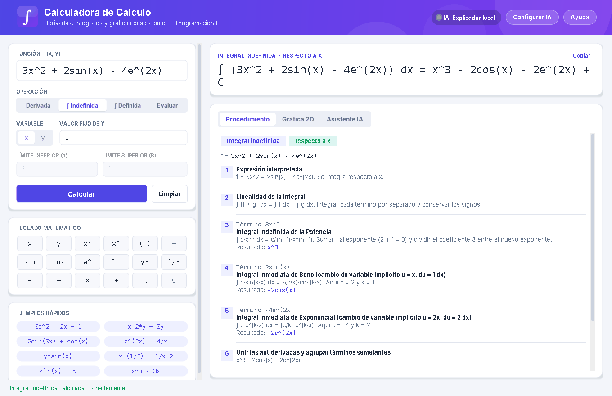
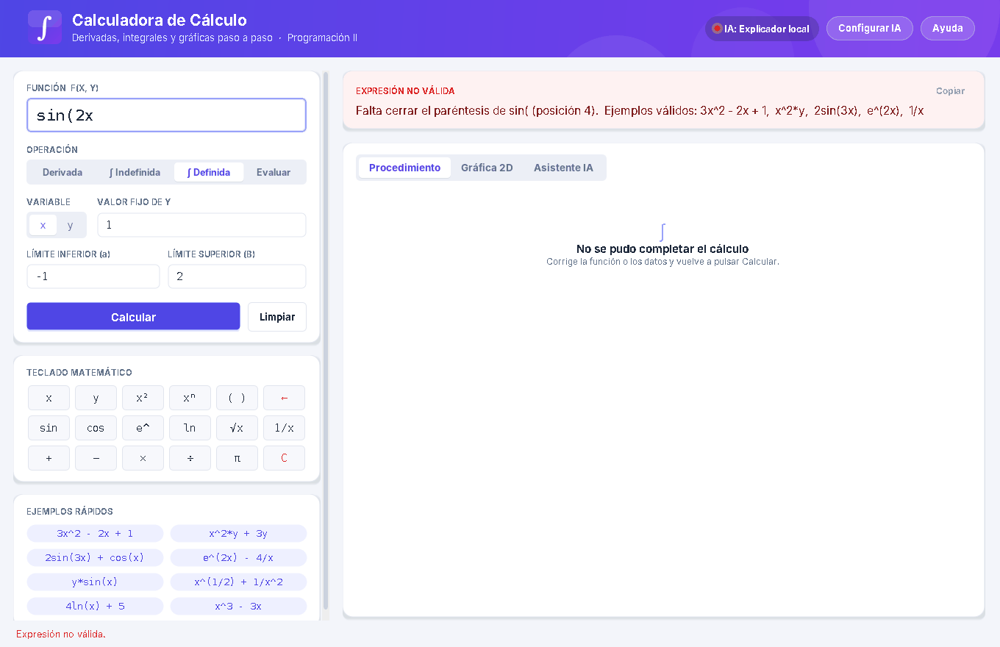
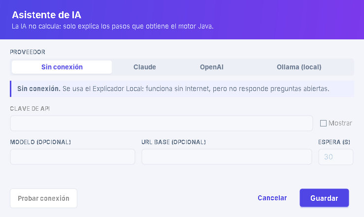

# Manual de Usuario

**Calculadora de Cálculo con Asistente de IA y Graficador Integral de Funciones**

---

## 1. Requisitos

- Windows 10 u 11.
- **JDK 11 o superior** instalado (por ejemplo, Eclipse Temurin u Oracle JDK). Compruébelo en PowerShell:

```powershell
java -version
javac -version
```

- Conexión a Internet **solo** si desea usar un asistente de IA en línea. Sin Internet, la calculadora funciona completa con el Explicador Local.

## 2. Instalación y ejecución

Abra PowerShell en la carpeta del proyecto (por ejemplo, Escritorio\calculadora java) y ejecute:

```powershell
.\build.bat              # compila y crea dist\CalculadoraCalculo.jar
.\ejecutar.bat           # abre la calculadora
.\ejecutar_pruebas.bat   # ejecuta las 99 pruebas automáticas
```

También puede hacer **doble clic** en `ejecutar.bat`. La primera vez compila automáticamente.

> Si PowerShell muestra "no se reconoce javac", instale el JDK y agregue su carpeta `bin` a la variable PATH.

## 3. La ventana principal



La ventana tiene tres zonas:

- **Encabezado:** muestra qué IA está activa (punto verde = IA en línea, punto ámbar = Explicador local) y los botones **Configurar IA** y **Ayuda**.
- **Columna izquierda:** los datos de entrada, el teclado matemático y los ejemplos rápidos.
- **Columna derecha:** la tarjeta de **resultado** y las secciones **Procedimiento**, **Gráfica 2D** y **Asistente IA**.

### Datos de entrada

| Campo | Descripción |
|---|---|
| **Función f(x, y)** | Expresión a calcular. Pulse Enter para calcular. |
| **Operación** | Selector: Derivada, ∫ Indefinida, ∫ Definida o Evaluar. |
| **Variable** | Variable de trabajo: x o y. La otra se trata como constante. |
| **Valor fijo de y (o x)** | Valor numérico de la otra variable, usado para graficar, evaluar e integrar definidamente. |
| **Límite inferior (a) / superior (b)** | Límites de la integral definida (o el punto, al evaluar). Admiten `1/2`, `pi`, `pi/2`. |

Botones: **Calcular** y **Limpiar**.

- **Teclado matemático:** inserta símbolos (x², √x, sin, cos, e^, ln, π...) donde está el cursor. `←` borra un carácter y `C` borra todo.
- **Ejemplos rápidos:** al hacer clic se copia el ejemplo y se calcula de inmediato.
- **Copiar** (en la tarjeta de resultado): copia el resultado al portapapeles.

Si hay un error, la tarjeta de resultado se pone roja y explica qué corregir:



### Sección "Procedimiento"

Muestra el procedimiento numerado: para cada término, el nombre de la regla, la explicación con coeficientes y exponentes, y el resultado parcial resaltado. Al final aparece el resultado en un recuadro verde.

### Sección "Gráfica 2D"


- **Línea índigo:** la función f.
- **Línea rosa discontinua:** la derivada (en derivadas) o la antiderivada con C = 0 (en integrales indefinidas).
- **Área turquesa:** área bajo la curva entre a y b (integrales definidas). Las zonas debajo del eje restan al resultado.
- **Rueda del ratón:** acercar o alejar (zoom centrado en el cursor).
- **Arrastrar:** mover la vista.
- **Doble clic** o botón **Restablecer vista:** volver a la vista inicial.

### Sección "Asistente IA"


1. Realice un cálculo.
2. (Opcional) Escriba una pregunta, por ejemplo: *¿por qué la derivada de una constante es cero?*
3. Pulse **Explicar con IA** (o Enter en el campo de la pregunta).

La IA **no calcula**: recibe los pasos que obtuvo el motor de la calculadora y los explica en texto sencillo (máximo 250 palabras). La etiqueta "Explicado por" indica qué fuente generó la explicación.

## 4. Cómo escribir las funciones

| Quiero escribir | Escriba |
|---|---|
| 3x² − 2x + 1 | `3x^2 - 2x + 1` |
| x²·y | `x^2*y` o `x^2y` |
| 1/x | `1/x` o `x^-1` |
| √x | `x^(1/2)` |
| (3/4)x² | `3/4x^2` o `(3/4)x^2` |
| 2·sen(3x) | `2sin(3x)` o `2sen(3x)` |
| cos(2y) | `cos(2y)` |
| e^(2x) | `e^(2x)`, `e^2x` o `exp(2x)` |
| ln(x) | `ln(x)` |
| π | `pi` |

**Reglas importantes**

- El argumento de sin, cos, e^ y ln debe ser lineal: `2x`, `-y`, `x/2`. No se admite `sin(x^2)`.
- No se admite multiplicar dos funciones: `sin(x)cos(x)`.
- Escriba los polinomios ya desarrollados: `x^2 + 2x` en lugar de `x(x + 2)`.

## 5. Ejemplos guiados

| Operación | Función | Variable | Datos | Resultado |
|---|---|---|---|---|
| Derivada | `3x^2 - 2x + 1` | x | — | `6x - 2` |
| Derivada parcial | `x^2*y` | y | — | `x^2` |
| Derivada | `y*sin(x)` | x | — | `ycos(x)` |
| Integral indefinida | `sin(2x)` | x | — | `-(1/2)cos(2x) + C` |
| Integral indefinida | `1/x` | x | — | `ln\|x\| + C` |
| Integral definida | `x^2` | x | a = 0, b = 3 | `9` |
| Integral definida | `sin(x)` | x | a = 0, b = pi | `2` |
| Evaluar | `x^2*y` | x | x = 2, y fijo = 3 | `12` |

## 6. Mensajes de error frecuentes

| Mensaje | Causa | Solución |
|---|---|---|
| **Expresión no válida** | Error de escritura (paréntesis sin cerrar, símbolo desconocido). | Revise la posición indicada y la tabla de sintaxis. |
| **Operación aún no soportada** | Requiere regla del producto o integración por partes (`x*sin(x)`, `∫ ln(x) dx`). | Es una técnica de un tema posterior; pruebe otra función. |
| **Fuera del dominio** | La integral es impropia (por ejemplo `1/x` en [−1, 1]) o hay raíces de negativos. | Elija un intervalo donde la función esté definida. |

## 7. Configurar el Asistente de IA (opcional)

La forma más fácil es desde la propia aplicación:

1. Pulse **Configurar IA** (en el encabezado o en la sección Asistente IA).
2. Elija el proveedor: **Sin conexión**, **Claude**, **OpenAI** u **Ollama (local)**.
3. Pegue su **clave de API** (Claude u OpenAI). Ollama no necesita clave.
4. Pulse **Probar conexión**. Debe aparecer "Conexión correcta".
5. Pulse **Guardar**. El encabezado mostrará el punto verde con el proveedor activo.



| Proveedor | Dónde obtener la clave | Costo |
|---|---|---|
| Claude (Anthropic) | console.anthropic.com → API Keys (empieza con `sk-ant-`) | Pago por uso |
| OpenAI | platform.openai.com → API keys (empieza con `sk-`) | Pago por uso |
| Ollama | Instale ollama.com y ejecute `ollama pull llama3.2` | Gratis, sin Internet |

La configuración se guarda en `config.properties`, en la carpeta del proyecto. También puede editar ese archivo a mano (vea `config.properties.ejemplo`) o definir la clave con una variable de entorno (PowerShell):

```powershell
$env:CALCULADORA_IA_API_KEY = "SU_CLAVE_AQUI"
.\ejecutar.bat
```

**Seguridad:** `config.properties` está en `.gitignore`; nunca suba su clave a GitHub ni la comparta.
Si no hay clave, no hay Internet o el proveedor falla, la calculadora usa automáticamente el **Explicador Local**.
