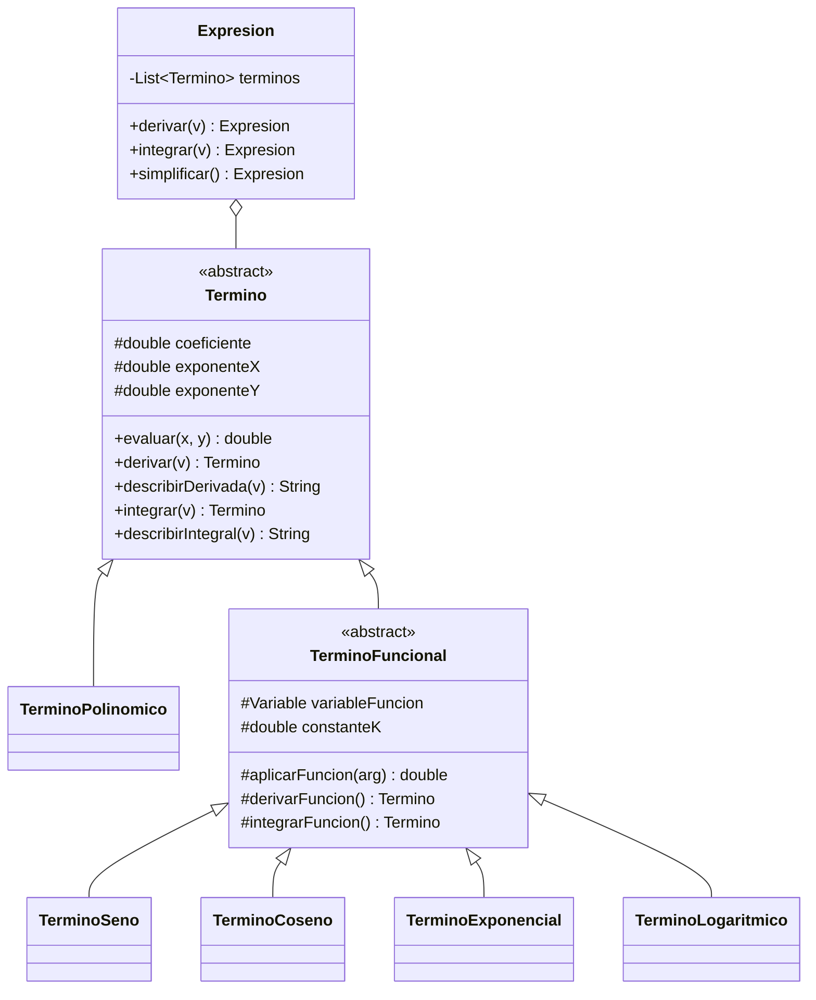
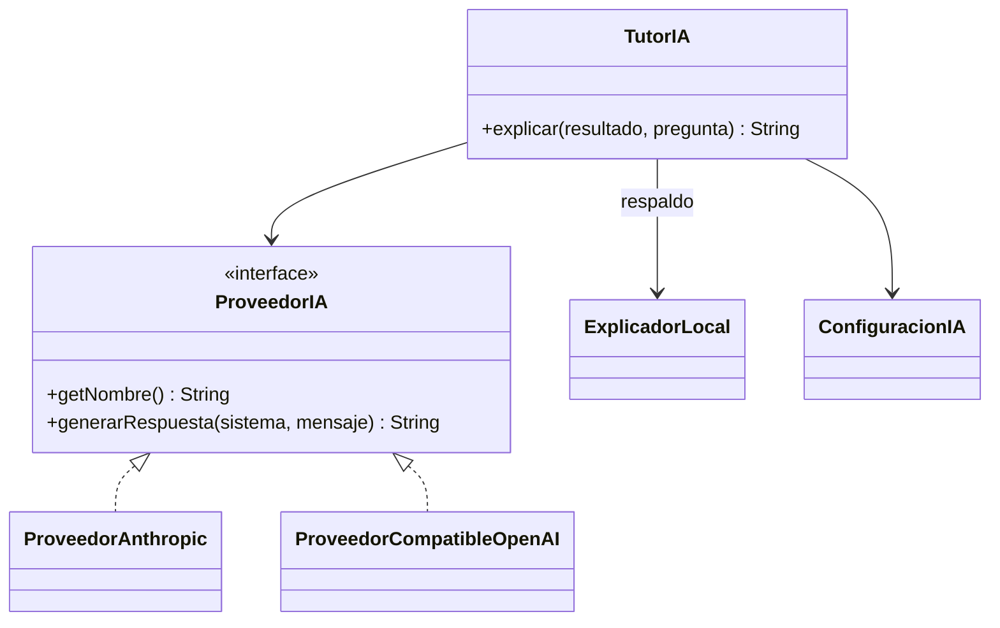
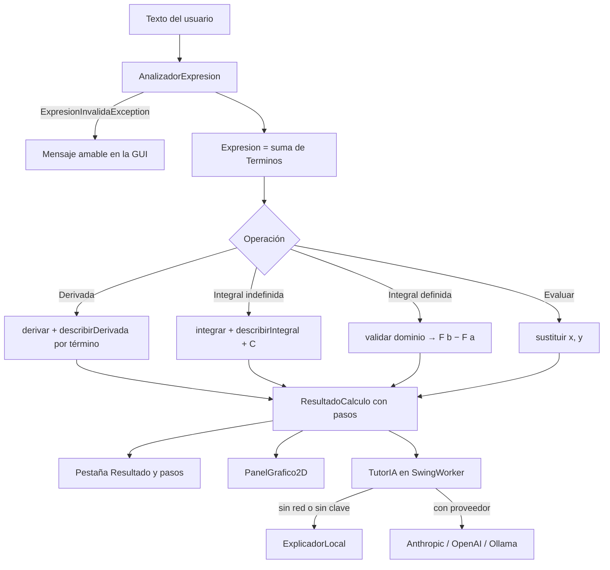
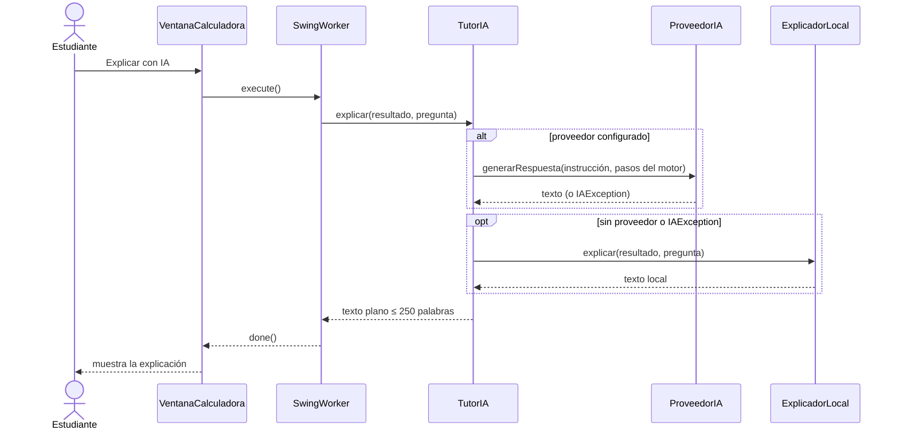

# Diagramas en Mermaid

Estos diagramas se visualizan directamente en GitHub, GitLab o en VS Code (extensión *Markdown Preview Mermaid Support*).

## Jerarquía de términos

## Módulo de IA

## Flujo de una operación

## Secuencia: explicación con IA y respaldo automático

